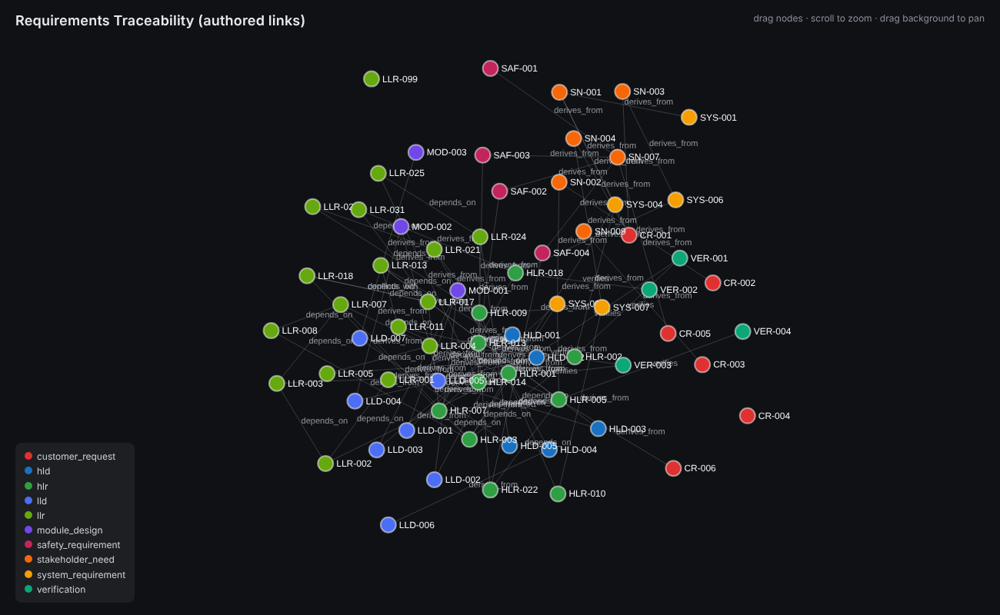

# Requirements Traceability Knowledge Graph

**A knowledge graph for requirements traceability, built in two layers: a dependency-free Python graph engine with an inference rule system, and a Neo4j version you can query with Cypher or by asking questions in plain English through a Streamlit chat UI (local LLM, read-only).**


-black)




## Contents

- [What it does](#what-it-does)
- [Why a graph](#why-a-graph)
- [Architecture](#architecture)
- [Data model](#data-model)
- [Quick start](#quick-start)
  - [Part A: Python engine only (no installs)](#part-a-python-engine-only-no-installs)
  - [Part B: Neo4j and the Streamlit Q&A app](#part-b-neo4j-and-the-streamlit-q-a-app)
- [Example questions](#example-questions)
- [Project layout](#project-layout)
- [Configuration](#configuration)
- [Testing](#testing)
- [Troubleshooting](#troubleshooting)
- [Using your own data](#using-your-own-data)
- [Design notes and limitations](#design-notes-and-limitations)

## What it does

Safety-critical engineering projects keep a chain of artefacts: customer requests, stakeholder needs, system and safety requirements, high-level and low-level requirements, designs, modules and the evidence that verifies them. The hard questions are all about *relationships* across that chain:

- *Why does this requirement exist?* (lineage back to the customer request)
- *What breaks if I change this?* (downstream impact)
- *Which module actually delivers this requirement?* (allocation)
- *What has no verification, or traces to nothing?* (quality gaps)
- *Which requirements conflict, and what blocks the most work?*

This project models that chain as a graph and answers those questions in three ways:

1. **In Python**, with a small in-memory triple store, path finding and an inference engine (standard library only).
2. **In Cypher**, by loading the same graph into Neo4j and running ready-made query scripts.
3. **In plain English**, through a Streamlit chat app where a local model (via Ollama) writes the Cypher, Neo4j runs it, and the model phrases an answer from the real rows. Every answer shows the generated query.

The bundled data is an illustrative sample: 68 artefacts across 10 layers, 91 authored links, and 337 more derived by inference rules.

## Why a graph

A requirements chain is not a tree. A single high-level requirement can derive from both a system requirement and a customer request, and a module can serve several designs. Trees and flat tables handle that badly; a graph does not. Because the vertical chain uses one relationship (`derives_from`), "upstream" and "downstream" are just the two directions of the same edge, so lineage, impact and depth-N neighbourhood queries are one-liners instead of special cases.

## Architecture

```
 sample_data.py ──► KnowledgeGraph (knowledge_graph.py)        pure Python, standard library
   68 artefacts        triples, query, neighbours,
   91 links            find_path, infer(rule), JSON save/load
                              │
          ┌───────────────────┼─────────────────────┐
          ▼                   ▼                     ▼
      rules.py             viz.py             neo4j/load_data.py
  5 inference rules   interactive HTML     nodes + relationships
  (lineage, impact,   graph (no CDN)               │
   allocation, ...)                                ▼
                                          Neo4j 5 (Docker)  ◄── neo4j/queries_demo.py
                                                   ▲             neo4j/layer_views.cypher
                                                   │ read-only Cypher
                      Ollama (local model) ──► neo4j/llm_qa.py ──► neo4j/streamlit_app.py
                      writes Cypher, phrases   Text2Cypher with     chat UI
                      the final answer         write-clause guard
```

## Data model

**Ten layers**, from customer to evidence:

| Layer | Label in Neo4j | Count |
|---|---|---|
| Customer request (`CR-*`) | `CustomerRequest` | 6 |
| Stakeholder need (`SN-*`) | `StakeholderNeed` | 6 |
| System requirement (`SYS-*`) | `SystemRequirement` | 5 |
| Safety requirement (`SAF-*`) | `SafetyRequirement` | 4 |
| High-level requirement (`HLR-*`) | `HLR` | 11 |
| Low-level requirement (`LLR-*`) | `LLR` | 17 |
| High-level design (`HLD-*`) | `HLD` | 5 |
| Low-level design (`LLD-*`) | `LLD` | 7 |
| Module design (`MOD-*`) | `ModuleDesign` | 3 |
| Verification evidence (`VER-*`) | `Verification` | 4 |

Every node also has the generic label `Entity` and the properties `name` (the artefact ID), `text` (the requirement wording), `status` and `programme`.

**Four authored relationship types:**

| Relationship | Meaning | Count |
|---|---|---|
| `DERIVES_FROM` | child points at the parent it came from (vertical) | 63 |
| `VERIFIES` | evidence points at what it verifies (vertical) | 6 |
| `DEPENDS_ON` | a peer at the same layer must be satisfied first (horizontal) | 20 |
| `CONFLICTS_WITH` | two peers are in tension and need resolving (horizontal) | 2 |

The horizontal links are what make a single-layer view readable. Using only the vertical chain, the high-level requirements would appear as disconnected dots, because each links up and down but never sideways.

**Five inference rules** (`rules.py`) derive 337 further facts from the 91 authored ones, so answers cannot drift out of step with what engineers actually wrote:

| Rule | Derives | Answers |
|---|---|---|
| `transitive_trace_rule` | `traces_to` | Why does this exist? Full lineage to the customer request |
| `impact_rule` | `impacts` | What breaks if I change this? |
| `implements_rule` | `implements` | Which module delivers this requirement? |
| `conflict_is_symmetric_rule` | `conflicts_with` (reverse) | A conflict is stored once and found from either side |
| `transitive_dependency_rule` | `requires` | Everything a requirement ultimately rests on |

**Planted defects.** The sample data deliberately contains quality problems so the queries have something to find: an orphan (`LLR-099`), five high-level requirements with no verification (`HLR-003`, `-007`, `-009`, `-010`, `-022`), and five artefacts with more than one parent.

## Quick start

### Requirements

| For | You need |
|---|---|
| Part A (Python engine) | Python 3.10 or newer. Nothing to install |
| Part B (Neo4j + Cypher) | Docker Desktop (or Docker Engine with the compose plugin) |
| Part B (plain-English Q&A) | [Ollama](https://ollama.com/download) and a model (a few GB) |

Works on macOS, Linux and Windows (PowerShell commands are given where they differ).

### Part A: Python engine only (no installs)

```bash
git clone https://github.com/Mounish16/knowledge-graph-neo4j.git
cd knowledge-graph-neo4j
python3 main.py
```

On Windows use `py main.py`. This runs a full demo: it builds the graph, runs example queries, finds the lineage of a module, runs the inference rules, saves and reloads the graph as JSON, and writes two interactive pages, `graph.html` (authored links) and `graph_inferred.html` (authored plus derived). Open either in any browser; drag nodes, scroll to zoom.

Run the tests:

```bash
python3 -m unittest discover -v
```

### Part B: Neo4j and the Streamlit Q&A app

**1. Start Neo4j** (first run downloads the image, a few hundred MB):

```bash
cd neo4j
docker compose up -d
docker compose logs -f
```

Wait for a line containing `Started.`, then press `Ctrl+C` (Neo4j keeps running). Neo4j Browser is at http://localhost:7474 (login `neo4j` / `password123`, a local development default set in `docker-compose.yml`).

**2. Create a virtual environment and install dependencies:**

macOS / Linux:

```bash
python3 -m venv .venv
source .venv/bin/activate
pip install -r requirements.txt
```

Windows (PowerShell):

```powershell
py -m venv .venv
.venv\Scripts\Activate.ps1
pip install -r requirements.txt
```

**3. Load the graph into Neo4j** and run the Cypher demo:

```bash
python load_data.py
python queries_demo.py
```

`load_data.py` clears the database and reloads it, so it is safe to re-run. You should see it load 68 entities and 91 relationships. To look at the graph, open http://localhost:7474 and run:

```cypher
MATCH (n)-[r]->(m) RETURN n, r, m
```

More ready-made views (single layers, conflicts, dependency chains, bottlenecks) are in [`neo4j/layer_views.cypher`](neo4j/layer_views.cypher); paste them into Neo4j Browser one at a time.

**4. Install Ollama and a model** (once):

```bash
brew install ollama            # macOS with Homebrew; otherwise use the installer from ollama.com/download
ollama serve                   # skip if the Ollama app or service is already running
ollama pull qwen2.5-coder:7b   # in another terminal; a few GB, first time only
```

On a machine with limited memory or disk, use a smaller model instead and tell the app about it:

```bash
ollama pull llama3.2
export OLLAMA_MODEL=llama3.2        # Windows PowerShell: $env:OLLAMA_MODEL="llama3.2"
```

**5. Start the chat app** (from the `neo4j` folder, with the virtual environment active):

```bash
streamlit run streamlit_app.py
```

It opens http://localhost:8501. Type a question at the bottom. Each answer shows the Cypher that was generated and the rows it returned, and the sidebar lets you change the Neo4j and Ollama connection settings and jump to Neo4j Browser. Prefer a terminal? `python llm_qa.py` gives the same Q&A as a prompt.

**Shutting down:**

```bash
docker compose down        # stop Neo4j, keep data
docker compose down -v     # stop Neo4j and delete the stored graph
```

## Example questions

Ask these in the Streamlit app (or `llm_qa.py`):

- Which requirements derive from HLR-001?
- What does LLR-007 ultimately trace back to?
- Which high-level requirements have no verification?
- Which modules implement HLR-002?
- What would be affected if CR-001 changed?
- Which requirements conflict with each other?
- Which requirement has the most other requirements depending on it?
- How many artefacts are there in each layer?

A small local model sometimes writes an imperfect query. If a question returns "Query failed" or an odd answer, rephrase it more specifically (name the exact relationship), or try a larger model: `ollama pull qwen2.5-coder:14b` then `export OLLAMA_MODEL=qwen2.5-coder:14b`.

Equivalent Cypher you can run yourself in Neo4j Browser:

```cypher
// Everything an LLR ultimately derives from (full lineage)
MATCH p = (:LLR {name: "LLR-007"})-[:DERIVES_FROM*]->(ancestor)
RETURN p;

// High-level requirements with no verification evidence
MATCH (h:HLR)
WHERE NOT (:Verification)-[:VERIFIES]->(h)
RETURN h.name, h.text ORDER BY h.name;

// Change impact of a customer request (everything downstream)
MATCH (:CustomerRequest {name: "CR-001"})<-[:DERIVES_FROM*]-(downstream)
RETURN DISTINCT downstream.name,
       [l IN labels(downstream) WHERE l <> "Entity"][0] AS layer
ORDER BY layer, downstream.name;
```

## Project layout

```
knowledge_graph.py        KnowledgeGraph engine: triples, query, neighbours, find_path, infer, JSON I/O
rules.py                  five inference rules (lineage, impact, allocation, conflicts, dependencies)
sample_data.py            the 68-artefact sample graph (the only file to change to use your own data)
viz.py                    exports an interactive, self-contained HTML graph
main.py                   end-to-end demo of everything above
test_knowledge_graph.py   30 unit tests (unittest, standard library)
GETTING_STARTED.md        step-by-step setup assuming nothing is installed (macOS)
graph.html                pre-generated visual: authored links
graph_inferred.html       pre-generated visual: authored plus inferred links
graph_export.json         pre-generated JSON export of the graph
docs/                     screenshots
neo4j/
  docker-compose.yml      Neo4j 5 container (Browser on 7474, Bolt on 7687)
  load_data.py            loads the graph into Neo4j as labelled nodes and relationships
  queries_demo.py         14 Cypher sections: lineage, impact, coverage, orphans, unverified, conflicts, ...
  layer_views.cypher      copy-paste views for Neo4j Browser
  llm_qa.py               Text2Cypher: local model writes Cypher, Neo4j runs it, model phrases the answer
  streamlit_app.py        chat UI around llm_qa.py
  requirements.txt        neo4j driver, streamlit
  README.md               details for the Neo4j part
```

## Configuration

All settings are environment variables with local-development defaults. The Streamlit sidebar can also override them at run time.

| Variable | Default | Meaning |
|---|---|---|
| `NEO4J_URI` | `bolt://localhost:7687` | Neo4j Bolt address |
| `NEO4J_USER` | `neo4j` | Neo4j user |
| `NEO4J_PASSWORD` | `password123` | Must match `NEO4J_AUTH` in `docker-compose.yml` |
| `OLLAMA_URL` | `http://localhost:11434` | Ollama server |
| `OLLAMA_MODEL` | `qwen2.5-coder:7b` | Model used to write Cypher and phrase answers |

`password123` is a throwaway default for a local container. If you expose Neo4j beyond your own machine, change `NEO4J_AUTH` in `docker-compose.yml` and set `NEO4J_PASSWORD` to match.

## Testing

```bash
python3 -m unittest discover -v
```

30 tests cover the engine (facts, queries, neighbours, path finding, JSON round trip), every inference rule, and the integrity of the sample data itself: no duplicate IDs, no links to missing artefacts, no self-references, no circular dependencies, horizontal links stay within one layer, every artefact has text and status, and the planted orphan and multi-parent artefacts stay present so the demo keeps its point. The tests need no Neo4j and no model.

The Neo4j loader, Cypher scripts and Text2Cypher app need the running services; check them with the Part B steps above.

## Troubleshooting

| Symptom | Fix |
|---|---|
| `docker compose up -d` fails with a connection error | Docker Desktop is not running. Open it, wait until it reports it is running, retry |
| `load_data.py` cannot connect | Neo4j needs 15 to 30 seconds after start. Check `docker compose logs -f` for `Started.` and retry |
| Streamlit shows "Can't connect to Neo4j" | Start Neo4j (`docker compose up -d`) and check the URI and password in the sidebar |
| Streamlit shows "Can't reach Ollama" | Run `ollama serve` (or start the Ollama app) |
| "Model ... isn't pulled yet" | Run `ollama pull <model>` for the model named in the message |
| Query failed or a strange answer | Rephrase with the exact relationship name, or use a larger model |
| Port 7474 or 7687 already in use | Stop the other Neo4j, or change the ports in `docker-compose.yml` and set `NEO4J_URI` |
| `bash setup.sh` not available on Windows | Use the PowerShell commands in Part B step 2 |

## Using your own data

`sample_data.py` is the only file that defines the content. It must expose `build_sample_graph()` returning a `KnowledgeGraph`. Add entities with `kg.add_entity(name, type=..., text=..., status=...)` and links with `kg.add_fact(subject, predicate, object)`. If you introduce a new `type`, add a matching label in `TYPE_TO_LABEL` in `neo4j/load_data.py`; unmapped types fall back to the generic `Entity` label, which would merge your layers into one. To add an inference rule, write a function `rule(kg)` that yields `(subject, predicate, object)` triples and add it to `ALL_RULES` in `rules.py`.

## Design notes and limitations

- **Two predicates for the vertical chain.** Only `derives_from` and `verifies` cross layers. Everything else (`traces_to`, `impacts`, `implements`, `requires`) is derived, so it cannot go stale.
- **Read-only by construction.** Any generated query containing a write clause (`CREATE`, `MERGE`, `DELETE`, `SET`, `REMOVE`, `DROP`, `DETACH`, `LOAD CSV`, `apoc` calls) is refused before it reaches Neo4j. That is a keyword check; for a real deployment also connect with a read-only Neo4j role.
- **Local and private.** The model runs on your machine through Ollama; no API key and no data leaves the machine.
- **Model quality.** A small local model is weaker at Cypher than a large hosted one. The live graph schema is sent with every question to keep queries grounded, and the generated query is always shown so you can check it.
- **Path-finding depth.** `find_path()` defaults to `max_depth=6`. A full chain from a module to a customer request is seven hops, so callers walking a whole chain must raise the limit (a test documents this).
- **Sample data only.** The artefacts are illustrative sample content for demonstration.

## Licence and data

The bundled sample data is illustrative and was created for demonstration and educational use.
